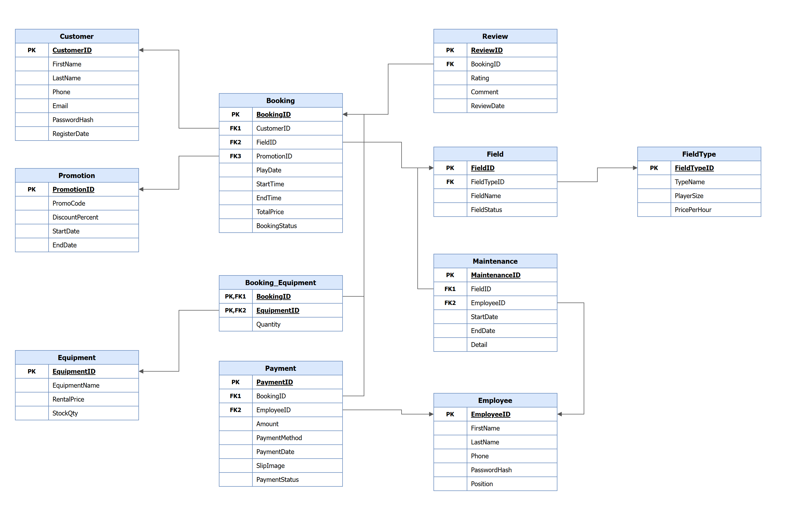

# KickOff — football pitch booking database (MySQL)

Relational database for a football-pitch booking business: customers book a pitch by the hour, rent equipment, use promo codes, upload a bank-transfer slip that staff approve, and leave a review afterwards.

Term project for a university database course (Silpakorn University, 2026), built by a team of three. **My part: database design (ERD and normalisation), all SQL, and the clickable prototype.**

**Tools:** MySQL 8.0+ (tested on 9.7) · draw.io · HTML prototype

## What's inside

| File | Contents |
|---|---|
| [`football_booking.sql`](football_booking.sql) | 11 tables, keys and CHECK constraints, 5 triggers, sample data (fictional people) |
| [`tests/test_business_rules.sql`](tests/test_business_rules.sql) | 23 automated checks, one or more per business rule — all pass |
| [`reports.sql`](reports.sql) | 5 management queries: revenue by pitch type (window function), hours booked per pitch, slips awaiting review, promo cost, customer value |
| [`docs/erd.png`](docs/erd.png) | Entity-relationship diagram after normalisation |
| [`docs/prototype.html`](docs/prototype.html) | Click-through prototype of the customer and staff screens (open in a browser) |



## Business rules enforced in the database

Rules that only need the row itself are CHECK constraints; rules that need other tables are triggers, so no client can bypass them.

| Rule | How |
|---|---|
| End time after start time; rating 1–5; discount 1–100%; stock ≥ 0 | CHECK constraints |
| One payment and at most one review per booking | UNIQUE keys |
| No booking on a pitch that is closed or inside a maintenance window | `trg_booking_check`, `trg_booking_update_check` |
| No overlapping bookings on the same pitch (cancelled bookings free the slot; back-to-back slots are allowed) | same two triggers, using the interval test `new.start < old.end AND new.end > old.start` |
| Promo code must be valid on the play date | same two triggers |
| Rented equipment cannot exceed the stock still free in that time slot | `trg_rent_check` |
| Reviews only for confirmed bookings, on or after the play date | `trg_review_check` |
| Approving a payment slip confirms the booking automatically | `trg_payment_approve` |

The update trigger re-checks only when the pitch, date, time or promo changes, or a cancelled booking is revived, so a status-only change (like the automatic confirmation above) is never blocked.

## Run it

```bash
mysql -u root -p < football_booking.sql
mysql -u root -p football_booking < tests/test_business_rules.sql   # expect "23 / 23 tests passed"
mysql -u root -p football_booking < reports.sql
```

Load the schema again before re-running the tests; they change the sample data.

## Known limitations

- **Race condition:** the overlap check reads existing rows, so two sessions inserting the same slot at the same instant could both pass. A production system should serialise bookings per pitch (for example `SELECT ... FOR UPDATE` on the pitch row inside a transaction).
- `TotalPrice` is calculated by the application and stored; the database does not recompute it.
- Equipment stock is checked when equipment is added, not when the booking's time is moved later.
- Sample passwords use unsalted `SHA2` for readability. Real passwords need a slow, salted hash such as bcrypt or Argon2, computed in the application.
- Enum values and messages are in Thai because the system was designed for a Thai business.
